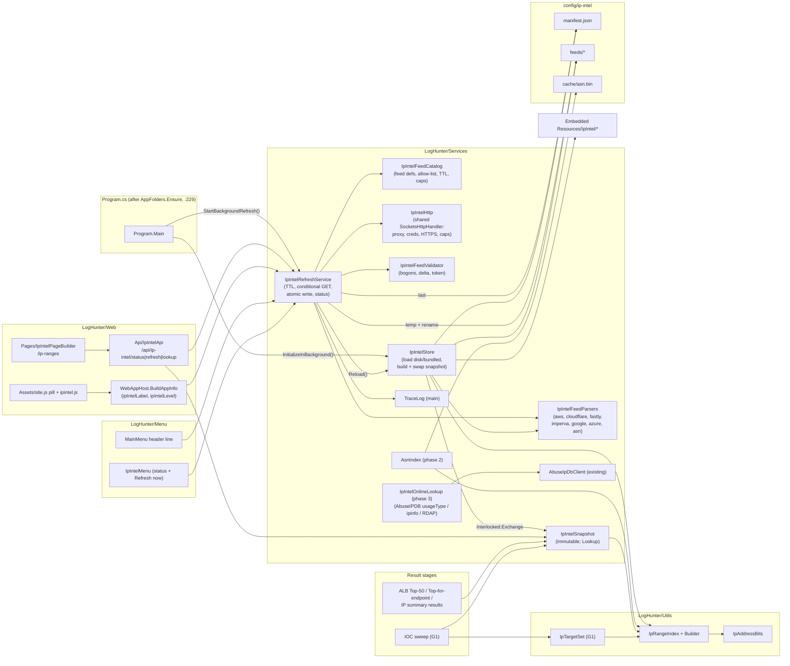

# CDN / proxy IP intelligence: update architecture (research D)

Written 2026-11-22 against `feature/iis-burst-scoring` (b9c0a14). Where `main` differs, `main` line numbers are given too. `main` carries `TraceLog` (d0aaa92 "Make the diagnosis trace always on"); this branch does not.

Scope: how LogHunter keeps a local CDN/cloud IP-range dataset current, how it stores and looks it up, and how status reaches the operator. It does not cover which badges go into which result views; that is G2 in `docs/ticket-gap-plan.md:52-66`.

Inputs read: `LogHunter/docs/cdn-detection-future-directions.md`, `docs/ticket-gap-plan.md` (G1, G2), `LogHunter/Services/ReleaseUpdateChecker.cs`, `LogHunter/Services/AbuseIpDbClient.cs`, `LogHunter/Services/AppFolders.cs`, `LogHunter/Program.cs`, `LogHunter/LogHunter.csproj`, `LogHunter/Web/**`, `main:LogHunter/Services/TraceLog.cs`.

---

## 0. Decisions in one table

| Topic | Decision | Why |
|---|---|---|
| Refresh trigger | Background refresh at startup (fire-and-forget) plus a manual **Refresh now**. Per-feed TTL: 24 h for vendor feeds, 7 d for Azure and ASN | Startup must never wait on the network. The current release check does wait (see 1.1) |
| Change detection | `If-None-Match` / `If-Modified-Since` on every feed. AWS and Google also check `syncToken` / `createDate` / `creationTime`, which must only move forward | A 304 is cheap. The token guards against stale CDN caches and rollbacks |
| Validation | Strict parse, bogon / too-wide prefix rejection, count delta within ±50 % (small feeds allow ±10 entries), token monotonic. If a check fails, keep the previous data | A bad feed must never wipe or poison the badges |
| Offline fallback | Raw vendor feeds embedded in the exe (`Resources/IpIntel/`), refreshed by a release-time script | First run and air-gapped WorkSpaces still get badges |
| On-disk format | Raw feed bodies plus `manifest.json`, parsed into memory at load. A compiled binary cache only for the ASN table (phase 2) | Vendor feeds parse in tens of ms. JSON and binary caches add code without measurable benefit |
| In-memory lookup | Immutable **sorted partition arrays**: `uint[]` for v4, `UInt128[]` for v6, a label-set id per interval, binary search | About 20–50 ns per lookup, about 1 MB, GC-friendly. The same engine serves `IpTargetSet` (G1) |
| Swap | `Interlocked.Exchange` of an immutable `IpIntelSnapshot`. Scans capture the reference once | Never blocks a scan. Each scan sees one consistent view |
| Network | One shared `SocketsHttpHandler`: system proxy (env vars first, then WinHTTP/PAC), default proxy credentials, HTTPS only, host allow-list, byte caps, 20 s per feed, 90 s per refresh | Works behind corporate proxies and never hangs |
| Online second opinion | Optional and operator-triggered only. Reuses the existing AbuseIPDB `usageType` first. ipinfo / RDAP only with a configured token, rate-limited and cached 30 days | Network is never required. IPs are never sent out without an explicit click |
| UI | Topbar status pill on every web page, an `/ip-ranges` page with a provider table and **Refresh now**, a line in the console main-menu header plus an **IP ranges** menu entry | Action-first and short, no roadmap wording |

---

## 1. Grounding: what exists today

### 1.1 Startup path

Current branch, `LogHunter/Program.cs`:

| Line | Code | Relevance |
|---|---|---|
| 200-204 | `--run-alb-download-job` child mode returns early | The IP intel layer must not start in child processes. It doesn't, if wired after line 229 |
| 206-227 | `--viewer-sqlite` returns early | Same |
| 229 | `AppFolders.Ensure();` | Folders exist from here on |
| 246 | `EmbeddedAssets.EnsureTabulatorAssets(root);` | Precedent for "extract embedded resource on startup" |
| 248 | `var session = new SessionState(root);` | |
| 249 | `await ReleaseUpdateChecker.CheckAsync(version)` | **Blocks startup up to 4 s** (timeout at `ReleaseUpdateChecker.cs:40-46`). The IP intel refresh must not copy this |
| 254 | `new WebAppHost(new WebAppContext(...))` | Web shell start |
| 279 | `new MainMenu(session)` | Console start |

On `main`: `AppFolders.Ensure()` at `main:Program.cs:235`, `TraceLog.Start(AppFolders.Logs, ...)` at `:239`, release check at `:272-273`, `WebAppHost` at `:277`, `MainMenu` at `:302`.

### 1.2 Patterns to reuse

| Pattern | Where | Reuse / deviation |
|---|---|---|
| State JSON under `AppFolders.Config` with `enabled` flag, cache duration, catch-all fallback | `ReleaseUpdateChecker.cs:20-21, 163-196, 272-291` | Same folder root and same `enabled` opt-out. **Deviation:** `SaveState` (`:182-193`) writes in place with `File.WriteAllText`. IP intel writes temp + rename |
| Bare `catch` returns cached state on any failure | `ReleaseUpdateChecker.cs:81-84` | Same "never throw to caller" contract, but record the reason in status and trace instead of swallowing it |
| Per-call `new HttpClient`, UA header, timeouts | `ReleaseUpdateChecker.cs:43-49`, `AbuseIpDbClient.cs:52-66` | **Deviation:** one shared handler (`IpIntelHttp`) so the proxy, credential and allow-list policy lives in one place |
| 429 / quota handling, `Retry-After` parsing | `AbuseIpDbClient.cs:88-111, 229-247` | Online second opinion reuses `AbuseIpDbClient.CheckAsync` as is. `UsageType` is already returned (`:130`) |
| Config load falls back to defaults on bad JSON | `AbuseIpDbClient.cs:140-157` | Same for `config/ip-intel/settings.json` |
| Immutable snapshot record + `lock` + `Update(jobId, s => s with {...})` | `Web/Orchestration/AbuseIpCheckJobManager.cs:12-27, 253-261, 273-303` | `IpIntelRefreshService.GetStatus()` returns an immutable `IpIntelStatus` the same way |
| Per-distinct-IP classification cache | `Services/IisClientIpResolver.cs:87-106` (`Dictionary<string, IpClass>`) | Same idea for CDN tagging of hot-loop IPs (IOC sweep) |
| Private-range check | `IisClientIpResolver.cs:66-85` | **v4 only**: IPv6 ULA (`fc00::/7`) and link-local (`fe80::/10`) are missed. The shared bogon list in `IpAddressBits` should cover both families and can later replace this |
| Exact string IP match in scanners | `AlbIpSummaryScanner.cs:397-400` (`resultsByIp.TryGetValue(clientIp, ...)`) | Unchanged. CDN tagging happens on distinct result IPs, not in the parser loop (see 3.5) |
| Diagnosis trace `TraceLog.Write(category, action, data)`, never throws | `main:LogHunter/Services/TraceLog.cs` (`Write`, `WriteBody`) | Category `ipintel` (events in 1.4) |
| App info JSON polled every 4 s by the shell | `WebAppHost.cs:150-154, 259-276`. `site.js:2` (`APP_INFO_POLL_MS = 4000`), `site.js:60-97` (maps `data-app-info` keys) | Add flat keys `ipIntelLabel`, `ipIntelLevel`. The pill updates with no new polling code |
| Topbar runtime pill | `WebShellPageBuilder.cs:102-106` | Sibling pill "IP ranges" |
| Home status pills | `WebShellPageBuilder.cs:169-178` (`subtle-status-row`) | Not used. The topbar pill shows on every page, which matters because badges appear on module pages |
| API module chain | `WebAppHost.cs:156-174` (`AlbApi`, `IisApi`, `PlatformApi`, `AbuseIpApi`) | Add `IpIntelApi.TryHandleAsync` after `AbuseIpApi` (`:171`) |
| Embedded assets | `LogHunter.csproj:35-52`, `WebAppHost.cs:27-35` (`AssetMap`) | Add `Web\Assets\ipintel.js` and `Resources\IpIntel\*` |
| Console header / warn helpers | `Menu/MainMenu.cs:19` (`ConsoleEx.Header`), `Utils/ConsoleEx.cs:31-33` (`Info`, `Warn`) | Status subtitle and stale warning |

### 1.3 Platform facts that shape the design

- `net8.0`, `win-x64`, self-contained single file, compressed, ReadyToRun, not trimmed (`LogHunter.csproj:16, 20-28`). So:
  - `System.UInt128`, `System.Net.IPNetwork` (new in .NET 8) and `IPAddress.TryParse(ReadOnlySpan<char>)` are available.
  - Reflection-based `System.Text.Json` is fine, because trimming is off.
  - Embedded resources are compressed inside the bundle, so embedding raw feeds costs their gzip size, not their raw size.
- `Microsoft.Data.Sqlite` is already referenced (`LogHunter.csproj:58`), so SQLite is an option at no extra package cost (rejected in 3.2).
- `AppFolders.Base` is the exe folder, independent of `--root` (`AppFolders.cs:9-10`). `ReleaseUpdateChecker` stores under it, while AbuseIPDB stores under the workspace root (`AbuseIpDbClient.cs:174-175`). IP intel follows `ReleaseUpdateChecker`: it is machine-level data, not per-investigation, so it goes in `AppFolders.Config/ip-intel`.
- There is **no test project** in the solution. G1 already requires unit tests (`ticket-gap-plan.md:50`), so this work and G1 share a new `LogHunter.Tests` project.

### 1.4 Trace events (category `ipintel`)

| Action | Data |
|---|---|
| `load` | `source` (bundled / disk / mixed), feeds, v4/v6 interval counts, `ms` |
| `refresh-start` | `trigger` (startup / manual), `force` |
| `feed` | `id`, `outcome` (not-modified / updated / rejected / failed / skipped-ttl), `http`, `bytes`, `ms`, `ranges`, `reason`, `proxy` (bool) |
| `swap` | new snapshot id, intervals, `ms` |
| `refresh-end` | counts per outcome, total `ms` |

Rejected bodies are logged through `TraceLog.WriteBody`, which is already size-bounded and redacting, with the first 500 bytes only.

---

## 2. Feeds

### 2.1 Catalog

Sizes are order-of-magnitude figures from public knowledge of these feeds. They must be measured when the parsers are written, and the measured values then become the validation baselines.

| Id | Provider / service | URL (host on allow-list) | Change detection | Raw size | Prefixes v4 / v6 (approx.) | Keep | TTL | Phase |
|---|---|---|---|---|---|---|---|---|
| `aws` | AWS (CloudFront, CloudFront origin-facing, Route 53 health checks, Global Accelerator, EC2, AMAZON) | `https://ip-ranges.amazonaws.com/ip-ranges.json` | ETag / Last-Modified + `syncToken` (epoch s) + `createDate` (`yyyy-MM-dd-HH-mm-ss`) | 1.5–2.5 MB | ~9–12k total; CLOUDFRONT ~150 / ~30 | All services, labelled per service | 24 h | 1 |
| `cloudflare-v4` / `cloudflare-v6` | Cloudflare | `https://www.cloudflare.com/ips-v4`, `/ips-v6` | ETag / Last-Modified | < 1 KB each | ~15 / ~7 | All | 24 h | 1 |
| `fastly` | Fastly | `https://api.fastly.com/public-ip-list` (JSON `addresses`, `ipv6_addresses`) | ETag | ~1 KB | ~20 / ~2 | All | 24 h | 1 |
| `imperva` | Imperva (Incapsula) | `https://my.imperva.com/api/integration/v1/ips` (POST `resp_format=json`, no auth) | Body hash (POST, no conditional GET) | ~1 KB | ~20 / ~5 | All | 24 h | 1 |
| `google` | Google (all) | `https://www.gstatic.com/ipranges/goog.json` | ETag + `syncToken` (epoch ms) + `creationTime` | ~10 KB | ~80 / ~30 | All, category Cloud/Google | 24 h | 1 |
| `google-cloud` | Google Cloud customer ranges | `https://www.gstatic.com/ipranges/cloud.json` | Same | ~100 KB | ~700 / ~150 | All, labelled `GCP <scope>` | 24 h | 1 |
| `azure` | Azure Service Tags (Front Door frontend/backend, AzureCloud) | Discovery page `https://www.microsoft.com/en-us/download/details.aspx?id=56519`, then `https://download.microsoft.com/download/.../ServiceTags_Public_YYYYMMDD.json` | `changeNumber` (monotonic) | 4–8 MB | tens of thousands across ~3k tags | Keep raw. Index only `AzureFrontDoor.*`, `AzureCloud` | 7 d | 1 (best-effort) |
| `asn` | iptoasn.com combined | `https://iptoasn.com/data/ip2asn-combined.tsv.gz` | ETag / Last-Modified | ~8 MB gz, ~30 MB raw | ~500–700k ranges | Full table (owner/ASN column for G3) plus curated CDN ASN list | 7 d | 2 (opt-out) |

Notes:
- **Origin-facing vs edge.** An ALB behind a CDN sees the CDN's *origin-facing* addresses. AWS publishes `CLOUDFRONT_ORIGIN_FACING`, a subset of `CLOUDFRONT`, and Azure publishes `AzureFrontDoor.Backend`. The label table therefore stores a `Role` (Edge, OriginFacing, HealthCheck, Cloud), and badges prefer the most specific role. `ROUTE53_HEALTHCHECKS` is worth a badge of its own, because health checkers show up in ALB top IPs.
- **Akamai** publishes no unauthenticated list. It is covered through ASN only (AS20940, AS16625, AS21342, AS35994, AS12222 and others), with `Source = Asn` and lower confidence. This matches the confidence model in `cdn-detection-future-directions.md:66-71` (IP range match = Medium; ASN = Low/Medium).
- **Azure** is the fragile one: the JSON URL changes weekly and has to be scraped from the download page. It is marked best-effort. Its failure never affects other feeds, and the bundled snapshot is refreshed every release.
- Later feeds of the same shape, each a parser plus a catalog entry and nothing else: Oracle `public_ip_ranges.json`, Bunny `edgeserverlist`, Gcore `public-ip-list`, Googlebot/Bingbot crawler lists (useful for "is this bot real").
- ASN alternatives:
  - DB-IP ASN Lite: monthly, CC BY 4.0, needs attribution in the UI.
  - MaxMind GeoLite2-ASN: needs a per-user licence key and an EULA review before any bundling; adds an MMDB reader dependency. Not a default. Can be supported later as "bring your own key".
  - iptoasn is public domain (PDDL), has no key and comes as sorted, non-overlapping ranges, which is exactly the shape the index wants.

### 2.2 Labels

```text
IpIntelLabel(Provider, Service, Category, Role, SourceFeedId)
  Provider   "Cloudflare" | "AWS" | "Fastly" | "Imperva" | "Google" | "Azure" | "Akamai" | <AS owner>
  Service    "CLOUDFRONT" | "CLOUDFRONT_ORIGIN_FACING" | "ROUTE53_HEALTHCHECKS" | "AzureFrontDoor.Backend" | ...
  Category   Cdn | Waf | Cloud | Asn
  Role       Edge | OriginFacing | HealthCheck | Cloud | Unknown
```

Priority when several labels cover one address (longest prefix first, then this order):

`Cdn/OriginFacing > Cdn/Edge > Waf > HealthCheck > Cloud (service) > Cloud (AMAZON / AzureCloud / goog) > Asn`

Badge text uses the existing wording rule `Likely <provider>` (`cdn-detection-future-directions.md:166-182`).

---

## 3. Storage and lookup

### 3.1 On-disk layout

```text
<exe>\config\ip-intel\
  settings.json            { enabled, autoRefresh, asnEnabled, staleDays, online: { provider, token } }
  manifest.json            per-feed state (see IpIntelFeedState), written last, atomically
  feeds\aws.json           raw body exactly as served (decompressed)
  feeds\cloudflare-v4.txt
  feeds\...                one file per feed id
  feeds\asn.tsv.gz         kept compressed
  cache\asn.bin            phase 2: compiled ASN index (versioned header + SHA-256 of source)
  refresh.lock             exclusive lock while refreshing (multi-instance guard)
```

`IpIntelFeedState` (one per feed in `manifest.json`):

```text
id, url, etag, lastModified, versionToken (syncToken/changeNumber/createDate), sourceCreatedUtc,
fetchedUtc (last 200), checkedUtc (last 200/304), sha256, bytes, v4Count, v6Count, parserVersion,
lastAttemptUtc, lastOutcome, lastError, pendingSha256, pendingSeenCount, pendingFirstSeenUtc
```

The bundled snapshot uses the same layout inside the assembly (`Resources/IpIntel/feeds/*` plus `Resources/IpIntel/manifest.json`), so one loader handles both sources.

### 3.2 Format comparison

| Option | Vendor feeds (~15–25k prefixes) | ASN table (~600k ranges) | Verdict |
|---|---|---|---|
| **Raw feed files, parsed at load** | ~3–10 MB on disk incl. Azure. Parse AWS ~20–40 ms, Azure ~60–120 ms, others < 5 ms. Re-parsable after a parser fix; diffable; hash-validated | Parse 30 MB TSV ~0.5–1 s, too slow for every start | **Use for vendor feeds** |
| Merged JSON (provider, service, cidr) | ~1–1.5 MB, parse ~20–50 ms | ~40–60 MB, parse several seconds | No gain over raw for vendors. Too big for ASN |
| **Custom binary** (header, label table, `uint[]` starts, `UInt128[]` starts, `ushort[]`/`int[]` label-set ids) | ~0.3–1 MB, load ~1–5 ms | v4 ~500k × 8 B + v6 ~150k × 20 B ≈ 7 MB, plus AS names ~2–4 MB. Load ~20–60 ms | **Use as ASN cache** (`cache/asn.bin`), rebuilt from `asn.tsv.gz` when its SHA-256 changes |
| SQLite | ~2 MB. A range query (`start <= ? ORDER BY start DESC LIMIT 1`) costs ~5–20 µs: 10M lookups ≈ 1–3 min. v6 needs BLOB keys | Same problem, ~40 MB | Rejected as the lookup path. You would still load it into memory. Fine later for G3 verdict memory, which is a different problem |

Embedded snapshot cost: AWS ~2 MB raw compresses to ~150–250 KB, Azure ~6 MB to ~400–700 KB, the rest is negligible. That adds roughly **0.6–1 MB** to the exe. The ASN table (~8 MB gz) is **not** embedded. It is downloaded on first refresh when `asnEnabled` is set, so an air-gapped machine simply has no ASN column.

### 3.3 Lookup structure

**Recommended: an immutable sorted partition with binary search.**

Build (once per snapshot, in `IpRangeIndexBuilder`):
1. Each prefix or range becomes `[start, end]` in its family's integer space: `uint` for v4, `UInt128` for v6. IPv4-mapped v6 (`::ffff:a.b.c.d`) is normalised to v4 on both insert and lookup.
2. Sweep all boundaries (`start` and `end + 1`) to produce **elementary intervals**: at most 2N+1 of them, non-overlapping and contiguous, including "no match" gaps.
3. For each interval, record the set of covering labels, ordered by (prefix length desc, priority). Label sets are deduplicated into a `int[][]` table, so each interval stores one `int` set id, with -1 for no match.
4. Output `uint[] V4Starts`, `int[] V4SetIds`, `UInt128[] V6Starts`, `int[] V6SetIds`, `int[][] LabelSets`, `IpIntelLabel[] Labels`, `IpRange[] SourceRanges` (for "matched CIDR" display).

Lookup: `i = UpperBound(V4Starts, ip) - 1; set = V4SetIds[i]`. That is one `MemoryExtensions.BinarySearch` on a span, with no allocation and no pointer chasing.

Comparison:

| Structure | Lookup cost (v4, ~30k intervals) | Memory (vendor set) | Build / update | Overlap handling | Notes |
|---|---|---|---|---|---|
| **Sorted partition + binary search** | ~15 compares, **~20–50 ns**. 1M lookups ≈ 20–50 ms | ~1 MB total (v4 30k × 8 B, v6 20k × 20 B, sets) | O(N log N) sort, rebuilt per refresh (ms) | Solved at build time (label sets) | Contiguous arrays, few GC objects, trivially serialisable to `asn.bin`. Same code for v4/v6 via generic `T : IComparable<T>` or two copies |
| Binary / Patricia trie | 8–32 dependent node hops, ~50–150 ns (cache misses) | 2N nodes × 32–48 B objects ≈ 2–3 MB plus GC pressure | Incremental insert | Natural longest-prefix match, but "all covering labels" needs a path walk | Incremental insert is not needed: the dataset is replaced wholesale |
| Multibit trie / poptrie (stride 8/16) | 2–4 hops, ~10–20 ns | 5–50 MB depending on stride, worse for v6 | Complex | Needs leaf pushing | Fastest, but the speed isn't needed: the target is ≥1M lookups/s, and the partition gives ~20M/s |
| `System.Net.IPNetwork.Contains` over a list | O(N) per IP: 25k × 10M rows is not feasible | Small | Trivial | None | Use only for **parsing/validation** of feed CIDRs and as the **test oracle** (8.1) |

IPv6 key: `System.UInt128` (built from `IPAddress.TryWriteBytes` plus big-endian read). Comparisons compile to two `ulong` compares. A `(ulong Hi, ulong Lo)` struct is the fallback if profiling shows `UInt128` overhead, but it shouldn't. Almost all CDN v6 prefixes are /64 or shorter.

Parsing cost dominates lookup cost. `IPAddress.TryParse` takes ~50–100 ns and allocates. `IpAddressBits.TryParseV4(ReadOnlySpan<char>, out uint)` (hand-written, no allocation, ~10 ns) handles the common case; v6 falls back to `IPAddress.TryParse(ReadOnlySpan<char>)` plus `TryWriteBytes(stackalloc byte[16])`.

`IPNetwork.TryParse` in .NET 8 rejects CIDRs with host bits set (`10.1.2.3/24`). For feeds that is correct, and such an entry counts as invalid. For `IpTargetSet` user input it is wrong, so its own lenient parser masks the host bits and reports the normalisation back to the user.

### 3.4 Sharing with `IpTargetSet` (G1)

`ticket-gap-plan.md:35-38` already says "build it once". Proposed split:

```text
Utils/IpAddressBits.cs        parse v4/v6/mapped -> uint / UInt128; CIDR + "a-b" range parse; bogon table (v4 + v6)
Utils/IpRangeIndex.cs         immutable partition (the arrays above) + Lookup(...) -> label-set id
Utils/IpRangeIndexBuilder.cs  Add(start, end, labelId, prefixLen) ; Build()
Utils/IpTargetSet.cs          G1: parses pasted text/CSV column into targets; labels = target ids; uses IpRangeIndex
Services/IpIntelSnapshot.cs   G2: labels = IpIntelLabel ids; uses IpRangeIndex
```

- `IpTargetSet` needs *all* matching targets: `1.2.3.0/24` and `1.2.3.4` can both be targets, and both must record a hit. The label-set design gives that for free.
- Single IPs go in as /32 or /128. That deviates from the G1 text, which says "HashSet for singles plus sorted ranges", but it keeps one code path. A `HashSet<uint>` fast path can be added only if a benchmark shows it matters. It is unlikely to, since both are O(1)–O(log n) on a few thousand targets.

### 3.5 Where lookups happen

- **G2 badges:** at the result stage, on **distinct** IPs (Top-50, Top-for-endpoint, IP summary, IOC sweep results). That is at most tens of thousands of lookups, so under 5 ms. The parser hot loops (e.g. `AlbIpSummaryScanner.cs:397-400`) stay untouched, as required by `cdn-detection-future-directions.md:14-20`.
- **G1 IOC sweep:** the hot loop over millions of rows. It uses `IpTargetSet` with a per-distinct-IP-string cache, the same pattern as `IisClientIpResolver.cs:87-106`. Distinct client IPs per scan are typically far fewer than rows, so parse plus lookup runs once per distinct IP.

### 3.6 Snapshot lifecycle and memory

| Item | Size in memory |
|---|---|
| Vendor-feed snapshot | ~1 MB arrays + ~50 KB labels |
| ASN index (phase 2) | ~7 MB arrays + ~3 MB AS names (string-interned) ≈ **10–15 MB**. Lazy-loaded on first use or right after the vendor snapshot in the background. Disabled by `asnEnabled = false` for low-RAM WorkSpaces |
| Swap | `IpIntelStore.Current` is a `volatile` reference to an immutable `IpIntelSnapshot`. A refresh builds a new snapshot off-thread, then `Interlocked.Exchange`. A scan reads `Current` once and keeps that reference |

`IpIntelStore.Current` is never null. The first access synchronously loads disk, or bundled if the disk copy is missing or corrupt. That is local work only (~50–150 ms for vendor feeds) and never touches the network.

---

## 4. Update mechanism

### 4.1 Component diagram



### 4.2 Startup refresh sequence

```mermaid
sequenceDiagram
  autonumber
  participant Main as Program.Main
  participant Store as IpIntelStore
  participant Ref as IpIntelRefreshService
  participant Http as IpIntelHttp
  participant Feed as Vendor endpoint
  participant Disk as config/ip-intel
  participant UI as Web pill / console header

  Main->>Main: AppFolders.Ensure() (Program.cs:229)
  Main->>Store: InitializeInBackground()
  Store-->>Disk: read manifest.json + feeds/*
  alt disk missing / corrupt / parserVersion mismatch
    Store-->>Store: load embedded Resources/IpIntel/*
  end
  Store->>Store: parse + validate + build IpRangeIndex
  Store->>Store: Interlocked.Exchange(Current)
  Store-->>UI: status = Loaded (source, age)
  Main->>Ref: StartBackgroundRefresh(trigger: startup)  [fire-and-forget]
  Note over Main: continues immediately: release check (:249),<br/>WebAppHost (:254) or MainMenu (:279)
  Ref->>Disk: try open refresh.lock (FileShare.None)
  alt lock held by another instance
    Ref-->>UI: status unchanged (other instance refreshing)
  else lock acquired
    loop each feed due (now - checkedUtc >= TTL), max 4 parallel
      Ref->>Http: GET url (If-None-Match, If-Modified-Since), 20 s
      Http->>Feed: HTTPS via system/env proxy
      alt 304 Not Modified
        Feed-->>Http: 304
        Ref->>Ref: state.checkedUtc = now
      else 200 OK
        Feed-->>Http: body (streamed, byte cap)
        Http->>Http: verify final host in allow-list
        Ref->>Ref: parse -> validate (bogons, delta, token monotonic)
        alt valid
          Ref->>Disk: write feeds/<id>.tmp, flush, File.Move(overwrite)
          Ref->>Ref: state = new etag/token/sha/counts
        else rejected
          Ref->>Ref: keep previous; lastError; pending-sha tracking
        end
      else network / proxy / TLS / timeout error
        Ref->>Ref: keep previous; lastError
      end
      Ref-->>UI: per-feed progress (status record)
    end
    Ref->>Disk: write manifest.tmp -> manifest.json (atomic)
    opt any feed updated
      Ref->>Store: Reload() (build new snapshot off-thread, swap)
    end
    Ref->>Disk: release refresh.lock
    Ref-->>UI: status = Updated / Partial / Failed (age, feeds ok/total)
  end
```

Wiring (proposed, not implemented):
- Current branch: insert after `Program.cs:246` (`EnsureTabulatorAssets`) and **before** `:249` (release check), so the 4 s release check does not delay the refresh start.
- `main`: after `TraceLog.Start` (`main:Program.cs:239`), before `:272`.

The refresh also runs in console mode. It writes nothing to the console while menus render, because Spectre output would interleave. Status is read when the menu header draws.

### 4.3 TTL, conditional requests and versions

- **Due check:** `now - checkedUtc >= Ttl`. **Refresh now** sets `force = true`, which ignores TTL but still sends conditional headers. A 304 is the correct answer to a forced refresh.
- **ETag / Last-Modified:** stored per feed and sent as `If-None-Match` / `If-Modified-Since`. Validators are ignored when the stored body is missing or fails its hash check, to avoid a 304 with nothing behind it.
- **AWS:** after parse, require `syncToken >= stored.syncToken`. On equality with a different SHA, accept but trace `token-equal-body-changed`.
- **Google:** `syncToken` is in milliseconds. **Azure:** `changeNumber` must be greater than or equal to the stored one.
- **Imperva:** POST, so no validators. Compare the SHA-256 of the canonicalised range list; an identical body counts as not modified.
- **Clock:** ages use local UTC and are clamped at 0, so a skewed clock never shows negative ages. The source `createDate` is shown as the dataset date, not `fetchedUtc`.

### 4.4 Validation (`IpIntelFeedValidator`)

Per entry:
- parses as v4/v6 CIDR via `IPNetwork.TryParse`, so host bits must be zero;
- prefix length is at least /8 (v4) or /16 (v6);
- does not overlap the bogon table (RFC 1918, 0/8, 127/8, 169.254/16, 100.64/10, 224/4, 240/4, documentation nets, `::/8`, `fc00::/7`, `fe80::/10`, `ff00::/8`, `2001:db8::/32`).

Per feed:
1. Body parses and required fields exist. For AWS that means `prefixes[].ip_prefix`, `prefixes[].service`, `ipv6_prefixes[].ipv6_prefix` and `syncToken`.
2. Invalid entries are at most 1 % of entries. Above that, the feed is rejected.
3. `v4Count + v6Count > 0`.
4. Delta versus the previous accepted state, or the bundled manifest if there is none: `|new - old| <= max(10, 0.5 × old)`.
5. Version token is monotonic (4.3).

On rejection: keep the previous feed and set `lastOutcome = rejected` with a reason. Record `pendingSha256`. If the same rejected body is seen on **3 refreshes spanning at least 48 h**, accept it ("sticky change"). This lets a genuine large change through without a release, while a one-off bad response never lands.

### 4.5 Atomic write and concurrency

- Write `feeds/<id>.json.tmp` (FileStream, `Flush(true)`), then `File.Move(tmp, final, overwrite: true)`. On NTFS this is a single `MoveFileEx(REPLACE_EXISTING)` on the same volume. `manifest.json` is written **last** the same way, so a crash between the two leaves the old manifest, whose SHA no longer matches the new feed file. The loader then falls back to bundled for that feed and the next refresh repairs it.
- Leftover `*.tmp` files are deleted at load.
- **Multi-instance:** `refresh.lock` opened with `FileShare.None, FileOptions.DeleteOnClose`. If it is held, skip the refresh; the other instance's result is picked up at the next start. Readers never lock, because they read files once at load.
- **Read-only exe folder** (some locked-down laptops): catch `UnauthorizedAccessException` / `IOException` on the first write. Keep the freshly downloaded data **in memory for this session** and show "Not saved: folder is read-only". No `%LOCALAPPDATA%` fallback in phase 1, because it would split state from the existing `config/` convention (`AppFolders.cs:10`). Revisit if this shows up in practice.

### 4.6 Network policy (`IpIntelHttp`)

```text
SocketsHttpHandler
  UseProxy = true, Proxy = null              -> HttpClient.DefaultProxy: HTTP(S)_PROXY / ALL_PROXY / NO_PROXY env vars first,
                                                then Windows system proxy incl. WPAD/PAC (WinHTTP)
  DefaultProxyCredentials = CredentialCache.DefaultCredentials   -> NTLM/Kerberos proxy auth (avoid 407 on corp proxies)
  AutomaticDecompression = All
  AllowAutoRedirect = true, MaxAutomaticRedirections = 3          (https->http downgrade is never followed by .NET)
  ConnectTimeout = 5 s, PooledConnectionLifetime = 5 min
HttpClient.Timeout = Infinite; per-request CTS = 20 s (azure/asn 60 s); whole refresh CTS = 90 s (asn 180 s)
User-Agent: LogHunter/<version> (+ip-intel)
```

- **TLS:** never override `ServerCertificateCustomValidationCallback`. Corporate TLS-inspection roots in the Windows store are trusted by SChannel automatically. If they aren't, the feed fails with a "TLS check failed" status, which is the correct outcome.
- **HTTPS_PROXY:** honoured by `DefaultProxy` on Windows. The `/ip-ranges` page shows which proxy was used (host only, no credentials) to help support.
- **No retries inside a refresh** beyond one retry on connection reset. TTL plus the next startup is the retry loop.

### 4.7 Staleness levels

Age is `now - min(sourceCreatedUtc ?? fetchedUtc)` across the **CDN-category** feeds. Cloud-only and ASN feeds don't drive the warning. Thresholds come from `settings.json` (`staleDays`).

| Level | Condition | Pill dot | Result-page banner |
|---|---|---|---|
| Fresh | age < 3 d | green (`.status-dot.is-online`, `site.css:545`) | none |
| Aging | 3 d ≤ age < 14 d | amber (new `.is-warn`) | none |
| Stale | age ≥ 14 d, or bundled-only and bundled age ≥ 30 d | red (`.is-offline`, `site.css:550`) | "CDN ranges are 41 days old. Badges can miss new edges. **Refresh now**" |
| Disabled | `enabled = false` | grey | none. Pill reads "IP ranges · auto-refresh off" |

CDN ranges change slowly: Cloudflare's list is nearly static, while CloudFront adds ranges every few weeks. Stale data mostly causes missed badges (false negatives) rather than wrong ones.

---

## 5. Optional online second opinion (phase 3)

Never automatic, never required, never during a scan.

| Source | Key | What it adds | Limits / cache |
|---|---|---|---|
| **AbuseIPDB `usageType`** (existing) | Existing key logic (`AbuseIpDbClient.cs:31-50`) | "Content Delivery Network", "Data Center/Web Hosting/Transit" | Existing quota handling (`:99-105`). Already wired to manual / burst / platform flows. The G3 "Check reputation" hand-off covers it, so no new client is needed |
| RDAP (G3) | none | Network name, owner, country | `rdap.org` bootstrap, then the registry host (allow-listed set: ARIN, RIPE, APNIC, LACNIC, AFRINIC). Max 1 req/s, max 50 per action |
| ipinfo Lite / ipinfo | user token in `settings.json` | ASN, org, privacy flags (paid) | Token bucket 1 req/s, stop on 429 using the same pattern as `AbuseIpDbClient.cs:99-111` |

- **Trigger:** a "Check online" action on result rows with no local match, capped at 50 IPs per click.
- **Cache:** `config/ip-intel/online-cache.json`, keyed by IP, 30-day TTL, max 10k entries, LRU-trimmed, written atomically. Results are labelled with their source ("ipinfo", "AbuseIPDB") and never merged into the range index.
- **Privacy:** IPs from customer logs go to a third party only on that explicit click. The `/ip-ranges` page states which provider is configured.

---

## 6. Security

| Risk | Control |
|---|---|
| Downgrade / MITM | HTTPS only: the catalog rejects non-`https` URLs at type-init. System TLS validation, never bypassed |
| Redirect to an unexpected host | After the response, `response.RequestMessage.RequestUri` host must be in that feed's `AllowedHosts`; otherwise reject. Allow-list in code: `ip-ranges.amazonaws.com`, `www.cloudflare.com`, `api.fastly.com`, `my.imperva.com`, `www.gstatic.com`, `www.microsoft.com`, `download.microsoft.com`, `iptoasn.com` |
| Azure discovery scraping as an injection path | The scraped URL must match `^https://download\.microsoft\.com/download/[0-9A-F/\-]+/ServiceTags_Public_\d{8}\.json$` before it is fetched |
| Oversized / zip-bomb body | `Content-Length` checked first, then a counting stream aborts at the cap. Caps: vendor 8 MB, Azure 16 MB, ASN 32 MB compressed / 128 MB decompressed |
| Code execution | None: feeds are data only. No scripts, no reflection on feed content, no remote feed catalog. Adding a feed requires a release |
| Poisoning (e.g. `0.0.0.0/0` tags everything as CDN) | Minimum prefix length, bogon rejection, delta check, sticky-change rule (4.4) |
| Feed text in UI / exports (service names, AS descriptions are third-party strings) | Length cap 128 chars. HTML-encode in pages (`WebUtility.HtmlEncode`, as `WebShellPageBuilder.cs:235`). `Markup.Escape` in Spectre. Excel: prefix `'` when a value starts with `= + - @` (formula injection) |
| Schema change | Per-feed parser with `ParserVersion`. Unknown fields are ignored and unknown service names kept verbatim. Missing required fields mean the feed is rejected and the previous one kept; status reads "Format changed"; the first 500 bytes go to the trace. If a stored raw feed fails to parse after an upgrade (parserVersion mismatch), that feed falls back to bundled and is marked due |
| Secrets | No keys needed for phase 1–2. Optional ipinfo token stored like the AbuseIPDB key (`AbuseIpDbClient.cs:159-172`) and never written to the trace (`TraceLog` already redacts AWS keys; add a `token` field redaction) |

---

## 7. UI

### 7.1 Web shell

| Where | What | Grounding |
|---|---|---|
| Topbar, next to Runtime | Pill `● IP ranges · 3 h`. Click opens `/ip-ranges`. Tooltip: `Cloudflare, CloudFront, Fastly, Imperva, Google, Azure · 7/8 feeds · checked 10:42` | Sibling of `WebShellPageBuilder.cs:102-106`. Values from `/api/app/info` via `data-app-info="ipIntelLabel"` (`site.js:73-81`), dot class from `ipIntelLevel`. No new polling: `site.js:99-103` already polls every 4 s |
| `/ip-ranges` page | First visible element: a provider table (Provider · Ranges v4/v6 · Dataset date · Status) with a **Refresh now** button above it. Below: proxy in use, folder, `Auto-refresh on startup` toggle, `ASN data` toggle | New `Web/Pages/IpIntelPageBuilder.cs`, routed in `WebShellPageBuilder.TryBuildPage` (`:20-44`), plus `/api/ip-intel/*` in new `Web/Api/IpIntelApi.cs`, chained in `WebAppHost.HandleAsync` after `:171`. **Not** a topbar nav pill (`Pages` array `:11-18`), because it is a status/utility page |
| Result pages with badges | Stale banner only at level Stale, with an inline **Refresh now**. Badge tooltip: `Likely Cloudflare · matched 104.16.0.0/13 · Cloudflare list 2026-11-20` | G2 views (`ticket-gap-plan.md:60-61`) |
| Home | Nothing extra. The topbar pill is already on every page | Guardrail 8 (minimal stacking) |

Status strings (short, direct, no roadmap language):

| State | Pill | `/ip-ranges` status cell |
|---|---|---|
| Refresh running | `IP ranges · refreshing` | `Checking…` |
| All good | `IP ranges · 3 h` | `Up to date` / `Updated 2 d ago` |
| Bundled only | `IP ranges · built-in 2026-11-01` | `Built-in list (2026-11-01)` |
| Feed failed | `IP ranges · 7/8` | `Refresh failed: proxy refused (407). Using list from 2026-11-20` |
| Rejected | same | `Rejected: range count fell 62 %. Using list from 2026-11-20` |
| Format change | same | `Format changed. Using list from 2026-11-20` |
| Read-only | `IP ranges · not saved` | `Not saved: folder is read-only` |

Words to avoid (CLAUDE.md guardrail 2): "preview", "coming soon", "planned", "beta". Azure's best-effort nature shows through behaviour (its status cell), not a label.

Side note, out of scope: the existing shell has implementation-state copy that conflicts with the same guardrail. Examples are "Future home for…" and "Section Placeholder" (`WebShellPageBuilder.cs:16-17`) and "remain available during the migration" (`:113`).

### 7.2 Console

- **`MainMenu` header** (`Menu/MainMenu.cs:19`): subtitle becomes `Workspace: <root> · IP ranges: 3 h`. At level Stale, add a `ConsoleEx.Warn("CDN ranges are 41 days old. Main menu → IP ranges → Refresh now.")` line, following the `main:MainMenu.cs:20-21` precedent for the trace notice.
- **New menu item** in `MainMenu` items (`:23-56`): `IP ranges`, description `CDN and cloud ranges used for badges. Status and refresh.` It opens `Menu/IpIntelMenu.cs`, which shows a Spectre table (same columns as the web page) and two actions: `Refresh now` (runs `RefreshAsync(force: true)` with a status spinner) and `Back`.

### 7.3 API

| Method / path | Body / response |
|---|---|
| `GET /api/ip-intel/status` | `IpIntelStatus`: level, label, `refreshing`, per-feed rows, proxy host, folder, settings |
| `POST /api/ip-intel/refresh` | `{ ok, status }`. If a refresh is already running, `ok = false` with message `Refresh already running` (same contract as `AbuseIpCheckJobManager.cs:38-43`) |
| `POST /api/ip-intel/settings` | `{ autoRefresh, asnEnabled }` |
| `GET /api/ip-intel/lookup?ip=` | Matches for one IP (support/debug and quick checks). Input validated with `IPAddress.TryParse` as in `AbuseIpApi.cs:77` |

---

## 8. Class and file proposals

Names follow the repo: PascalCase files named after the main type, the `Ip` acronym casing of `AbuseIpDbClient` / `IisClientIpResolver`, flat `Services/`, engines in `Utils/` as `ticket-gap-plan.md:35` proposes.

| File | Type(s) | Responsibility | Phase |
|---|---|---|---|
| `LogHunter/Utils/IpAddressBits.cs` | `static class IpAddressBits`, `enum IpFamily`, `readonly record struct IpRange` | Span parse v4 → `uint`, v6 → `UInt128`, mapped → v4. Strict CIDR (feeds) and lenient CIDR / `a-b` range (targets). Bogon table | 1 (shared with G1) |
| `LogHunter/Utils/IpRangeIndex.cs` | `sealed class IpRangeIndex` | Immutable partition arrays. `int LookupSet(uint)`, `int LookupSet(UInt128)`, `bool TryLookup(ReadOnlySpan<char>, out ReadOnlySpan<int> labelIds)` | 1 |
| `LogHunter/Utils/IpRangeIndexBuilder.cs` | `sealed class IpRangeIndexBuilder` | `Add(IpRange, int labelId)`, `Build()` sweep with label-set dedup | 1 |
| `LogHunter/Utils/IpTargetSet.cs` | `sealed class IpTargetSet` | G1 target parsing + matching on top of `IpRangeIndex` | G1 |
| `LogHunter/Services/IpIntelFeedCatalog.cs` | `static class IpIntelFeedCatalog`, `sealed record IpIntelFeedDefinition` | Feed ids, URLs, allowed hosts, method, TTL, byte caps, category, parser | 1 |
| `LogHunter/Services/IpIntelFeedParsers.cs` | `static class IpIntelFeedParsers`, `sealed record IpIntelFeedParseResult` | One `Parse<Feed>(Stream)` per feed → ranges + labels + version token + created date. Private DTO records with `JsonPropertyName` (style of `ReleaseUpdateChecker.cs:266-270`) | 1 |
| `LogHunter/Services/IpIntelFeedValidator.cs` | `static class IpIntelFeedValidator` | Rules in 4.4. Returns `IpIntelValidationResult` (ok / reason) | 1 |
| `LogHunter/Services/IpIntelHttp.cs` | `static class IpIntelHttp` | Shared handler/client (4.6). `GetConditionalAsync(def, state, ct)` → `IpIntelFetchResult` (NotModified / Body(path) / Error(kind, message)) | 1 |
| `LogHunter/Services/IpIntelManifest.cs` | `sealed record IpIntelManifest`, `sealed record IpIntelFeedState`, `sealed record IpIntelSettings` | Persisted state, load-with-default (style of `AbuseIpDbClient.cs:140-157`), atomic save | 1 |
| `LogHunter/Services/IpIntelSnapshot.cs` | `sealed class IpIntelSnapshot`, `sealed record IpIntelLabel`, `sealed record IpIntelMatch` | Index + labels + per-feed provenance. `IpIntelMatch? Lookup(string ip)`, `IReadOnlyList<IpIntelMatch> LookupAll(string ip)` | 1 |
| `LogHunter/Services/IpIntelStore.cs` | `static class IpIntelStore` | `Current`, `InitializeInBackground()`, `Reload()`. Disk → bundled fallback per feed. Extracts nothing to disk (reads embedded streams directly) | 1 |
| `LogHunter/Services/IpIntelRefreshService.cs` | `static class IpIntelRefreshService`, `sealed record IpIntelStatus`, `sealed record IpIntelFeedStatus` | `StartBackgroundRefresh(string version)`, `Task<IpIntelStatus> RefreshAsync(bool force, CancellationToken)`, `GetStatus()`. Lock file, TTL, atomic writes, trace | 1 |
| `LogHunter/Services/AsnIndex.cs` | `sealed class AsnIndex`, `sealed record AsnMatch` | iptoasn TSV → `IpRangeIndex` + AS name table. `cache/asn.bin` build/load | 2 |
| `LogHunter/Services/IpIntelOnlineLookup.cs` | `sealed class IpIntelOnlineLookup` | Optional RDAP / ipinfo with token bucket + cache. AbuseIPDB via the existing client | 3 |
| `LogHunter/Web/Api/IpIntelApi.cs` | `internal static class IpIntelApi` | Endpoints in 7.3 (style of `AbuseIpApi.cs:15-45`) | 1 |
| `LogHunter/Web/Pages/IpIntelPageBuilder.cs` | `internal static class IpIntelPageBuilder` | `/ip-ranges` page | 1 |
| `LogHunter/Web/Assets/ipintel.js` | — | Page script: Refresh now, table render, settings toggles | 1 |
| `LogHunter/Menu/IpIntelMenu.cs` | `public sealed class IpIntelMenu : IMenu` | Console status + refresh | 1 |
| `LogHunter/Resources/IpIntel/manifest.json`, `LogHunter/Resources/IpIntel/feeds/*` | — | Bundled snapshot (`EmbeddedResource`, `CopyToOutputDirectory="Never"`, as `LogHunter.csproj:36-51`) | 1 |
| `tools/refresh-ip-intel-snapshot.ps1` | — | Release-time download into `Resources/IpIntel/`, runs the same validation through a `--ip-intel-validate <folder>` flag, writes the manifest. Answers the open question at `ticket-gap-plan.md:199`: refreshed every release **and** in-app | 1 |
| `LogHunter.Tests/LogHunter.Tests.csproj` | xUnit | First test project. Needs `InternalsVisibleTo("LogHunter.Tests")` because most types are `internal` | 1 |

Edits to existing files (proposed only):

| File : line | Change |
|---|---|
| `Services/AppFolders.cs:10, 25-38` | Add `IpIntel = Path.Combine(Config, "ip-intel")`. `Ensure()` creates it |
| `Program.cs:246-249` (`main:239-272`) | `IpIntelStore.InitializeInBackground(); IpIntelRefreshService.StartBackgroundRefresh(version);` before the release check |
| `Program.cs:298-316` (`ShowHelp`) | Document `config\ip-intel\settings.json` `"autoRefresh": false` for air-gapped use. No new CLI flag |
| `Web/Hosting/WebAppHost.cs:27-35` | `AssetMap` entry for `/assets/ipintel.js` |
| `Web/Hosting/WebAppHost.cs:171` | Chain `IpIntelApi.TryHandleAsync` |
| `Web/Hosting/WebAppHost.cs:259-276` | `BuildAppInfo` adds `ipIntelLabel`, `ipIntelLevel` |
| `Web/Pages/WebShellPageBuilder.cs:20-44, 102-106` | Route `IpIntelPageBuilder`. Add topbar pill |
| `Web/Assets/site.js:41-97` | Set pill dot class from `ipIntelLevel` |
| `Web/Assets/site.css:537-555` | `.status-dot.is-warn` |
| `Menu/MainMenu.cs:19, 23-56, 64-136` | Header subtitle, stale warning, `IP ranges` item |
| `LogHunter.csproj:35-52` | Embedded `Resources\IpIntel\**`, `Web\Assets\ipintel.js` |

---

## 9. Failure-mode table

| # | Failure | Detection | Behaviour | Operator sees |
|---|---|---|---|---|
| 1 | Offline / no DNS (air-gapped WorkSpace) | `HttpRequestException` (`SocketError.HostNotFound`) within the 5 s connect timeout | Keep disk or bundled data. No retry until next start / manual | `Refresh failed: no network. Using list from <date>` |
| 2 | Proxy needs auth (407) | Status 407 | Default credentials already sent. Fail the feed | `Refresh failed: proxy refused (407)` + proxy host on `/ip-ranges` |
| 3 | TLS inspection root not trusted | `AuthenticationException` | Fail the feed, never bypass | `Refresh failed: TLS check failed` |
| 4 | Captive portal / block page returns 200 HTML | Parser fails (JSON) or no valid CIDR lines (text) | Reject, keep previous | `Format changed. Using list from <date>` (trace has the body head) |
| 5 | Slow link | Per-feed 20 s / refresh 90 s CTS | Cancel the remaining feeds. Scans unaffected | `Refresh failed: timed out` |
| 6 | 304 | Status 304 | `checkedUtc = now` only | `Up to date` |
| 7 | Truncated body | JSON exception / count delta | Reject | `Rejected: …` |
| 8 | Schema change | Required field missing | Reject, keep previous, trace snippet | `Format changed…` |
| 9 | Large legitimate change | Delta > threshold | Reject until the same SHA has been seen 3× over ≥ 48 h, then accept | `Rejected: range count rose 70 %` → later `Updated` |
| 10 | Stale CDN edge / rollback | `syncToken` / `changeNumber` older than stored | Reject | `Rejected: older than current list` |
| 11 | Oversized / bomb | Byte cap | Abort the stream | `Rejected: response too large` |
| 12 | Redirect off allow-list | Final host check | Reject | `Rejected: unexpected host` |
| 13 | Azure download page changed | URL regex finds nothing | Azure feed fails, others proceed | Azure row: `Refresh failed: download link not found` |
| 14 | Exe folder read-only | `UnauthorizedAccessException` on first temp write | Use the new data in memory for this session | Pill `not saved` |
| 15 | Two LogHunter instances | `refresh.lock` held | Second instance skips the refresh | No change |
| 16 | Corrupt cache (crash, AV quarantine, hand edit) | SHA mismatch / parse failure at load | That feed falls back to bundled and is marked due | `Built-in list (<date>)` for that row |
| 17 | Crash mid-refresh | Leftover `.tmp`, manifest older than feed | Delete `.tmp`. SHA check falls back to bundled (#16) | — |
| 18 | Upgrade changes parser | `parserVersion` mismatch | Re-parse from the raw file; if that fails, bundled + due | — |
| 19 | Old exe, very old bundle, no network | Age ≥ 30 d | Works with the old data | Red pill + stale banner |
| 20 | Bogon / too-wide prefix in feed | Per-entry validation | Drop the entry; reject the feed if > 1 % of entries are invalid | `Rejected: invalid ranges` |
| 21 | Scan starts during refresh / swap | — | Scan holds its captured `IpIntelSnapshot`; the new snapshot applies to the next scan | — |
| 22 | First access before background load finishes | `Current` lazy init | Synchronous local load (≤ ~150 ms), no network | — |
| 23 | Low memory (ASN) | `asnEnabled` setting; `OutOfMemoryException` caught around ASN build | ASN disabled for the session, vendor badges unaffected | ASN row: `Off: not enough memory` |
| 24 | Online lookup quota / 429 | Existing `AbuseIpQuotaExceededException` / 429 | Stop the batch, keep cached answers | Existing AbuseIPDB quota message |
| 25 | Clock skew | Negative age | Clamp to 0 | — |

---

## 10. Test plan

### 10.1 Unit tests (new `LogHunter.Tests`, xUnit)

**`IpAddressBits`**
- v4, v6 (compressed, full, uppercase), IPv4-mapped v6 normalised to v4.
- Rejects zone ids (`fe80::1%3`), empty input, whitespace-only, `ip:port`.
- Pins the behaviour for leading zeros / octal-looking input (`010.1.1.1`), because IOC lists contain them and `IPAddress.TryParse` accepts legacy forms. Decide and assert.
- Strict CIDR rejects host bits. Lenient CIDR masks them and reports the normalisation.
- `/0` and `/7` rejected for feeds. `/32` and `/128` accepted.
- `a-b` ranges with `start > end` rejected. Mixed-family ranges rejected.

**`IpRangeIndexBuilder` / `IpRangeIndex`**
- Overlapping prefixes (`AMAZON ⊃ CLOUDFRONT ⊃ CLOUDFRONT_ORIGIN_FACING`): the most specific label comes first and all labels are present.
- Adjacent, duplicate and identical ranges from two feeds.
- Edge addresses: `0.0.0.0`, `255.255.255.255`, `::`, `ffff:…:ffff`, first and last address of each range, and first address after a range.
- Empty index.
- **Property test:** 5k random prefixes (both families) and 200k random IPs, compared against a brute-force oracle using .NET 8 `IPNetwork.Contains`.

**`IpIntelFeedParsers`**
- Golden fixtures per feed under `LogHunter.Tests/Fixtures/IpIntel/` (trimmed real samples).
- Mutations: missing `prefixes`, missing `syncToken`, extra unknown fields (still accepted), empty arrays, HTML body, truncated JSON, BOM, CRLF and LF text, Azure with no Front Door tags.

**`IpIntelFeedValidator`**
- Delta thresholds, including the small-feed absolute floor (Cloudflare 15 → 22 accepted; 15 → 3 rejected).
- Token regression rejected.
- Bogon entries.
- More than 1 % invalid entries rejects the feed.
- Sticky acceptance after 3 sightings over ≥ 48 h, using an injected clock.

**`IpIntelHttp` / `IpIntelRefreshService`** (fake `HttpMessageHandler`, temp folder)
- 200 with ETag → stored. The second run sends `If-None-Match` and a 304 causes no file write.
- 407, timeout, connection reset (one retry), redirect to a non-allow-listed host, http URL in the catalog (type-init failure), oversize body.
- `force` ignores TTL but keeps the validators.
- Lock held → skip.
- Read-only folder → in-memory status `not saved`.
- Crash simulation: kill between temp write and manifest write, then confirm the loader falls back to bundled for that feed and cleans up the `.tmp`.

**`IpIntelStore`**
- Empty disk → bundled. Corrupt feed → bundled for that feed only. `parserVersion` mismatch → re-parse.
- A reader holding the old snapshot during a swap keeps consistent results.

### 10.2 Performance checks (Stopwatch-based tests tagged `Perf`, or BenchmarkDotNet in a side project)

| Check | Target |
|---|---|
| Vendor snapshot load (bundled, cold) | < 150 ms |
| 1M v4 lookups (mixed hit/miss, pre-parsed) | < 100 ms |
| 1M lookups from strings (parse + lookup) | < 400 ms |
| ASN `asn.bin` load | < 100 ms; TSV → bin build < 3 s |
| Memory | Vendor snapshot < 5 MB; with ASN < 30 MB |
| Refresh of all due feeds (normal link) | < 10 s; all-304 < 2 s |

### 10.3 Manual / integration

1. **First run offline** (NIC disabled), fresh folder: badges work from bundled data, pill shows `built-in <date>`, trace has `load source=bundled`.
2. **Online first run:** all feeds `updated`. Second start within TTL: all `skipped-ttl`. **Refresh now:** all `not-modified` (304) except Imperva (hash compare).
3. **Corporate proxy:**
   - system proxy with PAC;
   - `HTTPS_PROXY` env var pointing at Fiddler, with Fiddler's root trusted (TLS-inspection path) and with it untrusted (expect "TLS check failed");
   - an authenticating proxy (expect success with default credentials, or a clean 407 message).
4. **AWS WorkSpaces, locked down:** exe in a read-only folder, so `not saved` is shown and scans are unaffected.
5. **Two instances started together:** one refreshes, the other skips, no corrupt files.
6. **Startup timing:** with the network blackholed (firewall drop), the web shell URL prints and the console menu draws with no added delay versus today (only the existing 4 s release check remains).
7. **Web:** the pill updates within one 4 s poll after a refresh. **Refresh now** while a refresh is running returns `Refresh already running`. The stale banner appears when the clock is set +20 d.
8. **Console:** header line and the `IP ranges` menu table + refresh.
9. **G2 acceptance** (`ticket-gap-plan.md:64-66`): the 3476636 Top-for-endpoint output shows Cloudflare badges and the banner.
10. **Release pipeline:** `tools/refresh-ip-intel-snapshot.ps1` runs before publish. The signed single-file exe contains `Resources/IpIntel/*`. Check via `/api/ip-intel/status` `source=bundled` on a clean folder.

---

## 11. Phasing

| Phase | Content | Size |
|---|---|---|
| 1a | `IpAddressBits`, `IpRangeIndex(+Builder)`, tests: shared with G1 `IpTargetSet` | S–M |
| 1b | Catalog, parsers (AWS, Cloudflare, Fastly, Imperva, Google, Azure), validator, bundled snapshot, `IpIntelStore`, tests | M |
| 1c | `IpIntelHttp`, `IpIntelRefreshService` (TTL, conditional GET, atomic, lock), trace, startup wiring | M |
| 1d | `/api/ip-intel/*`, `/ip-ranges` page, topbar pill, console menu | S–M |
| 2 | `AsnIndex` (iptoasn), Akamai via ASN, owner/ASN column for G3 | M |
| 3 | Online second opinion (RDAP / ipinfo), cache, rate limits | S–M |

## 12. Open questions

- Should the ASN table download by default (~8 MB on first refresh) or only after the operator enables it? The proposal is default **on**, but skipped while the bundled vendor data is the only source and the link failed (no point retrying an 8 MB download behind a broken proxy).
- `--root` workspaces: keep IP intel machine-level (`AppFolders.Config`, as proposed), or per workspace like AbuseIPDB?
- Should an operator be able to accept a delta-rejected feed by hand (an "Accept anyway" on the row), or is the 3-sightings sticky rule enough? The proposal is sticky-only, which keeps one less button.
