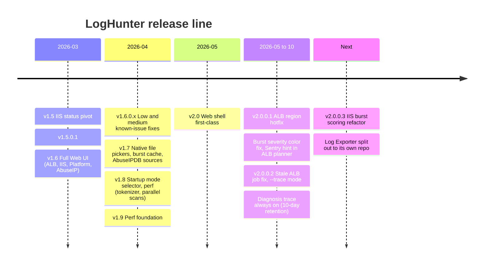
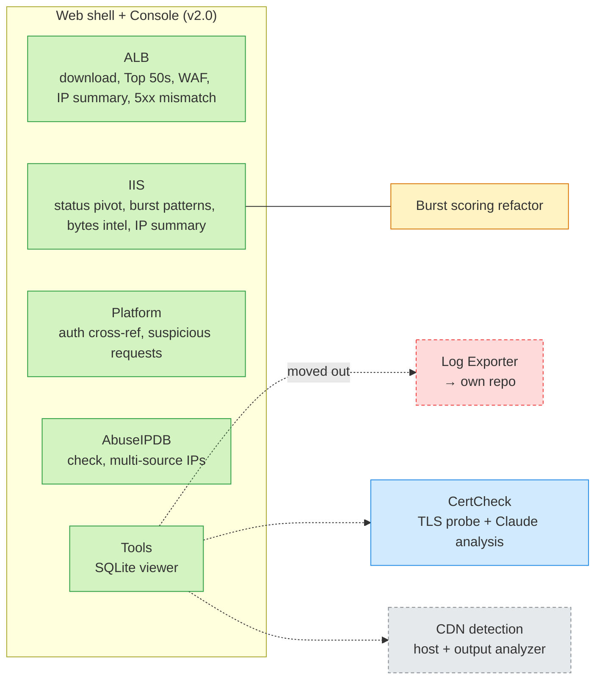
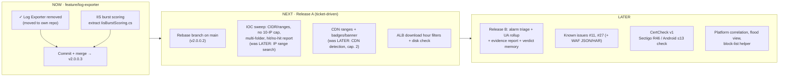

# LogHunter — State, Roadmap & Ideas

Snapshot @2026-11-17 · branch `feature/log-exporter` · `main` at **v2.0.0.2**

> [!IMPORTANT] Right now
> **Log Exporter now lives in its own private repo**, [AfonsecaOutsys/LogExporter](https://github.com/AfonsecaOutsys/LogExporter), and is removed from LogHunter's working tree. `feature/log-exporter` now only holds the uncommitted **IIS burst scoring refactor**, and the branch is behind `main` (v2.0.0.2 + always-on trace). There are stray junk files in the repo root too (see Housekeeping).

## Release timeline



## Current state — module map



<span style="color: #2f9e44">■ shipped</span> · <span style="color: #d97706">■ in progress</span> · <span style="color: #228be6">■ planned (design written)</span> · <span style="color: #868e96">■ idea</span> · <span style="color: #f03e3e">■ outside LogHunter</span>

Decided: LogHunter keeps the Tools section (SQLite viewer) but drops anything that opens a connection to a customer database.

## Roadmap — Now / Next / Later



> [!NOTE]
> NEXT/LATER were re-prioritised from 105 Zendesk tickets (Aug–Nov 2026). Gap-by-gap mapping and per-item plans: [ticket-gap-plan.md](ticket-gap-plan.md).

### Work items

| Item | Status | Source |
| --- | --- | --- |
**Open**

| Item | Status | Source |
| --- | --- | --- |
| IIS burst scoring refactor (`IisBurstScoring.cs`, job manager, UI) | <span style="color: #d97706">uncommitted</span> | working tree |
| #11 Bandwidth / Upload results readability | open | [known-issues.md](known-issues.md) |
| #27 WAF blocked summary + top blocked rework | open (needs analysis) | known-issues.md |
| CertCheck tool | design written | [design.md](../LogHunter/docs/design.md), [handoff.md](../LogHunter/docs/handoff.md) |
| G1 IOC sweep (CIDR, >10 IPs, multi-folder, scope report) | planned · Release A | [ticket-gap-plan.md](ticket-gap-plan.md) |
| G2 CDN intelligence layer + badges in ALB results | planned · Release A | ticket-gap-plan.md |
| G3 Sweep → AbuseIPDB hand-off, RDAP/ASN, verdict memory | planned · A / B | ticket-gap-plan.md |
| G4 IIS alarm triage preset, UA rollup, "Copy for SOC" | planned · Release B | ticket-gap-plan.md |
| G6 ALB download hour filters, disk check, corrupt-gz report | planned · Release A | ticket-gap-plan.md |
| G7 Shared evidence report (scope + caveats, UTC + local) | planned · Release B | ticket-gap-plan.md |
| G5 / G8–G11 Platform correlation, WAF JSON/HAR, flood view, block-list helper, expert IIS heuristics | later | ticket-gap-plan.md |
| G12 "Which module for which ticket" card + macro step | now, no code | ticket-gap-plan.md |

**Done / dropped**

| Item | Outcome |
| --- | --- |
| ~~Remove Log Exporter and its DB-connection code~~ | <span style="color: #2f9e44">done</span>: moved to [AfonsecaOutsys/LogExporter](https://github.com/AfonsecaOutsys/LogExporter), which now plans to fold it into PlanCatcher as a "Log Export" tab. Removal not yet committed here. |
| ~~#25 / #26 / #28 file pickers + burst cache~~ | <span style="color: #2f9e44">shipped in v1.7</span> (`633bd11`) |
| ~~Execution plans tool~~ | <span style="color: #868e96">dropped</span> |
| ~~Cold-start time investigation~~ | <span style="color: #868e96">closed</span> |

## Ideas backlog — value vs effort

My rough estimates; move the points to match your own view.

```2x2
x: Low effort -> High effort
y: Low value -> High value
quadrants: Quick wins | Big bets | Fillers | Money pits
- Known issue #11 readability: 0.25, 0.45
- Known issue #27 WAF output: 0.5, 0.6
- CertCheck v1: 0.7, 0.8 !
- CDN host detection: 0.55, 0.5
- CDN output analyzer: 0.75, 0.45
- CDN ranges + badges in results: 0.4, 0.7
- IIS reader migration: 0.6, 0.3
- CertCheck crt.sh sweep (v2): 0.8, 0.55
- IP range search → IOC sweep (IIS + ALB): 0.4, 0.9 !
- ALB download hour filters: 0.2, 0.6
- Alarm triage preset + Copy for SOC: 0.5, 0.8
- Evidence report: 0.45, 0.7
- Platform correlation: 0.8, 0.65
- Block-list helper: 0.4, 0.4
```

<div data-tabs>
<details data-tab>
<summary>Tools ideas</summary>

- **SQLite viewer** — already shipped; the Tools section stays for it.
- **IP range search (IIS + ALB)** — search logs for IP ranges (CIDR such as `203.0.113.0/24`, or start–end) instead of single IPs. Shows matching IPs with hit counts, then hands off to IP summary or AbuseIPDB.
- **CertCheck** — probe a host's DNS, TLS, chain and HTTP, check trust against bundled Android/iOS/NSS root stores, then send the findings to Claude for interpretation. Headline check: missing Sectigo R46 cross-sign.
- **CDN detection** — two separate analyzers: (1) is this host behind a CDN, (2) flag CDN-shaped traffic in finished Excel/CSV/SQLite outputs. Kept out of the ALB parsers on purpose.

</details>
<details data-tab>
<summary>v2 follow-ups</summary>

- CertCheck: crt.sh subdomain sweep, multi-host sweep, baseline diff, offline PEM-bundle mode.
- Log Exporter follow-ups live in PlanCatcher now (the LogExporter repo is retired). Roadmap: `plancatcher/docs/roadmap.md`.
- **PlanCatcher publication streamlining** (TODO, branch `publication-streamlining` in the plancatcher repo): add proper versioning, a live check for new versions with update download, and configuration/streamlining of version control and releases.

</details>
<details data-tab>
<summary>Tech debt</summary>

- IIS reader migration (no-break swap of `IisW3cReader` internals) — [iis-reader-migration-plan.md](iis-reader-migration-plan.md).
- Remaining items from the perf scan — [perf-scan-2026-04-26.md](../LogHunter/docs/perf-scan-2026-04-26.md).

</details>
</div>

## Open questions

- **CertCheck:** who provides the Anthropic API key internally? Bundle trust stores in the exe or pull them on demand?
- **Versioning:** do new features ship as a v2.0.0.x patch (the default) or as v2.1?

## Housekeeping

- Stray files in the repo root, probably from broken shell redirects: `,+`, `200`, `500)bad.push([f`, `LogHunter/Web/Hosting/WebAppHost.cs(211`, `` line.Length` ``, `statusCode.HasValue`, `string.IsNullOrWhiteSpace(startUtc)`. Delete before committing.
- `docs/execution-plans-tool-plan.md` and `docs/startup-diag-results.md` describe dropped/closed work. Delete or archive them when convenient.
- Local branches with nothing left to merge into `main`: `back-to-top`, `sqlite-viewer-card`, `investigate-first-startup`, and all three `hotfix/v2.0.0.x` branches. Safe to prune.
- `docs/session-bookmark.md` describes the April medium-fixes session and is out of date.
