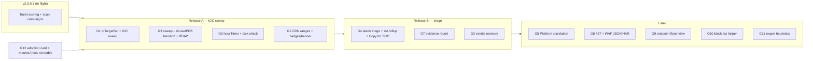

# Ticket-driven gap plan

Source: 105 Zendesk security / IIS / ALB / IP tickets (2026-08-22 → 2026-11-21) · full analysis in `C:/Zendesk/docs/security-log-tooling-gap-analysis-2026-11-22/` · written 2026-11-22 against `feature/iis-burst-scoring` (83b6cf7)

## 1. What already matches the roadmap

| # | Gap from tickets | Existing roadmap / idea / shipped item | Match | What the code says today |
|---|---|---|---|---|
| G1 | IP sweep: 10-IP cap, no CIDR, one source at a time | **IP range search (IIS + ALB)** — LATER, 2x2 "high value / low effort" | **Partial.** The idea covers CIDR / ranges but not >10 IPs, list import, multi-source or a hit / no-hit report | Cap is hard-coded in 4 places (`alb.js:1449`, `iis.js:349`, `AlbIpSummaryJobManager.cs:48`, `IisIpSummaryJobManager.cs:54`). IP summary keeps heavy per-IP state (minute buckets, endpoints, one Excel sheet per IP), so the cap is reasonable *for IP summary*. Matching is exact string lookup (`AlbIpSummaryScanner.cs:399`) |
| G2 | Real client IP hidden behind CDN / LB | **CDN detection** idea (`LogHunter/docs/cdn-detection-future-directions.md`: shared intelligence layer + export analyzer) | **Partial.** The design exists; nothing is built | IIS side is **already done**: `IisClientIpResolver` prefers `OriginalIP`/XFF and skips private hops. ALB logs carry no XFF, so the ALB side can only *flag* CDN edges and point to IIS |
| G3 | Block requests without a hit check; IOC lists re-worked; manual RDAP / AbuseIPDB | **AbuseIPDB module** (shipped v1.6 / v1.7: manual paste, output file, burst cache) | **Shipped, under-used.** Manual paste already exists; people still used the website. Missing: RDAP / ASN, verdict memory, hand-off from a sweep | `AbuseIpPageBuilder.cs:95` "Manual entry" source |
| G4 | HTTP-error alarms escalated raw; SOC recounts in Splunk | **IIS status pivot, burst patterns, IIS IP summary** (shipped) + **burst scoring refactor** (in progress) | **Shipped, unused** in the sample. Missing: UA breakdown summary, alarm-window preset, SOC-ready text | IIS IP summary stores UA per row (`IisIpSummaryScanner.cs:309`) but has no UA rollup |
| G5 | "Did they get in?" — IP → user → outcome | **Platform: authenticated activity check** (shipped) | **Partial.** Has a suspicious-IP → auth signal; no Screen Requests (XFF) ingestion, no login-attempt export join | Roadmap decision: no customer-DB connections → login data must come in as an exported file |
| G6 | Log acquisition and scale (43.5 GB filled disk, corrupt archives) | **ALB S3 download** (shipped), perf scan follow-ups | **Partial** | `AlbDownload.cs:206-266` syncs **whole day prefixes**, then prunes to the window, so a 2-hour window costs a full day per ALB. No disk check, no corrupt-gz report |
| G7 | Customer / regulator evidence packaging | — | **New** | Each module writes its own HTML / Excel; nothing states scope + caveats |
| G8 | ODC / WAF: Splunk WAF JSON + HAR correlated by hand | **Known issue #27** WAF blocked summary rework | **Partial.** #27 is ALB WAF output only | — |
| G9 | Distributed attacks (13k rotating IPs) invisible in top-IP views | **Scan campaigns** (83b6cf7, unreleased) | **Partial.** Campaigns group by UA + URL set and catch rotating *scanners*; a low-rate-per-IP flood never forms per-IP bursts | `IisBurstScoring.cs:359` campaign fingerprint |
| G10 | Block mechanics: 20-entry NACL, CIDR / ASN collateral, WAF IP set | — | **New** | — |
| G11 | Expert heuristics live in private scripts (`iis_filter.py`, `iis_timeline.py`, `iis_burst_detail.py`) | **IIS reader migration** (tech debt) | **Partial.** Same area, different goal | — |
| G12 | Adoption: only ALB IP lookup is used | — | **New (no code)** | 13 users, 23 / 105 tickets, IIS / Platform / WAF modules never seen |

**Bottom line:**
- G1 and G2 are already on the roadmap as ideas, and the tickets say they are worth doing now.
- G3 and G4 are mostly already built; the gap is hand-off and awareness.
- G7 and G10 are new.

## 2. Plan per gap

Sizes: **S** ≤ 1 day · **M** 2–4 days · **L** ≥ 1 week.

### G1 · IOC sweep (promote "IP range search") — M

- **Goal:** answer "were these N IPs / ranges ever in our logs?" in one run, for any list size.
- **Approach:**
  1. New `Utils/IpTargetSet.cs`:
     - parses single IPs, CIDR (v4 / v6) and `start-end` ranges from pasted text or a CSV / xlsx column;
     - lookup is a `HashSet` for singles plus sorted ranges with binary search.
     - This is the **same CIDR engine the CDN intelligence layer needs (G2)**, so build it once.
  2. New lightweight **IOC sweep** job for ALB and IIS, separate from IP summary so its per-IP state stays unchanged. Per target it records: hits, first / last seen, distinct matched IPs (for ranges), top 5 URIs, status mix, source folder / environment.
  3. Input = several folders in one job (one per environment / ALB). Results are grouped per folder.
  4. Output: per-target hit / no-hit table plus a **scope block**: files, lines, parse failures, observed time range per folder. `3557308/report.md` is the template.
  5. Hand-offs from the results:
     - "IP summary for hits" passes the ≤ 10 IPs with hits to the existing scan.
     - "Check reputation" passes **all** targets, zero-hit included, to AbuseIPDB (G3).
  6. Keep the 10-IP cap on IP summary, and change its error text to "Use IOC sweep for longer lists".
- **Done when:**
  - 34 targets (18 IPs + 16 CIDR) run in one job (the 3557308 case);
  - a /27 needs no manual expansion (3523149);
  - the 15-IP split runs disappear (3474380 / 3474366);
  - unit tests cover IPv4 / IPv6 / CIDR / range edges and malformed lines.

### G2 · CDN-aware client IP (promote "CDN detection", capability 2 + shared layer only) — M

> [!IMPORTANT]
> Superseded in detail by [research/cdn/README.md](research/cdn/README.md), the multi-angle research done on 2026-11-22. It covers vendor feeds, third-party services, detection methods validated on ticket data, in-app update design and a customer vendor census. It adds a **P0 patch**: `IisClientIpResolver` picks the leftmost (forgeable) XFF hop and misses `0.0.0.0` / CGNAT / IPv6 private ranges.

- **Goal:** stop "top IP = Cloudflare edge" conclusions.
- **Approach:**
  1. Build the **CDN intelligence module** exactly as designed:
     - bundled snapshot of AWS `ip-ranges.json` (CLOUDFRONT), Cloudflare, Fastly, Akamai and Imperva published ranges;
     - manual refresh, with a `last updated` stamp shown;
     - lookup goes through `IpTargetSet`.
  2. Mark CDN / AWS ranges in ALB Top-50, Top-for-endpoint, IP summary and the IOC sweep results with a provider badge, and add an Excel column.
  3. If ≥ 50 % of the top-N hits are CDN edges, show a banner: "Traffic is fronted by <provider>; the ALB sees edges, not clients → run IIS IP summary (uses X-Forwarded-For)."
  4. IIS: no change to resolution. Add a sanity warning when every resolved IP is private (`OriginalIP` column missing).
- **Not now:** capability 1 (the website probe) and the offline analyzer for old exports.
- **Done when:**
  - the 3476636 Top-for-endpoint output (`setpassword`) shows Cloudflare badges and the banner;
  - an IIS file without `OriginalIP` produces the warning.

### G3 · Enrich any list + verdict memory — S/M

- **Approach:**
  1. **Hand-off (S):** an "Check reputation" button on the IOC sweep results and on the Top-50 results pre-fills AbuseIPDB manual entry.
  2. **RDAP / ASN column (S):** owner, ASN, country and network from a free RDAP lookup, cached locally alongside the AbuseIPDB cache. CDN / cloud membership comes from G2.
  3. **Verdict memory (M):** local SQLite `ioc_history` (IP / range, ticket #, date, hit / no-hit, scope, AbuseIPDB score). The sweep shows "seen before: #3533172 on 2026-11-12, 0 hits" next to each target. It is local only; sharing it across the team would need a shared location (open question below).
- **Done when:** re-running the 3533172 list shows the earlier result, and zero-hit IPs can be enriched without retyping.

### G4 · Alarm triage preset — M

- **Goal:** L1 / L2 produce what SOC currently rebuilds in Splunk before escalating.
- **Approach:**
  1. New IIS card **"HTTP-error alarm triage"**: pick folder plus window (alarm time ± N min). It runs the existing status pivot, IP summary (top 10 by error count) and burst / campaign scoring in one pass where possible, otherwise chains them.
  2. Add a **UA rollup** to IIS IP summary: top UAs per IP, with tool UAs flagged (curl, python-requests, httpx, Go-http-client, sqlmap, nuclei…). Data is already parsed at `IisIpSummaryScanner.cs:309`.
  3. **Login heuristic:** POSTs to login endpoints (`Login`, `Solutions.asmx`, `/Users/`, `PasswordReset`) per IP per hour, with the 302-vs-200 split.
  4. **"Copy for SOC"** button: plain text in the SOC sub-ticket shape (window, top IPs with error share, UA mix, URIs, flags, AbuseIPDB). The SOC template wording comes from 3544248 / 3441416.
- **Done when:** the 3440663 case (1,079 POST 500s to `Solutions.asmx` from one IP) comes out of a single run with the user agent included. SOC's extra question was the UA.

### G5 · Platform correlation ("did they get in?") — L

- **Approach:**
  1. Extend the Platform module to ingest **Screen Requests**, **Error** and **General** exports (CSV / xlsx) and read the forwarded IP. Error logs carry it in `EnvironmentInformation`, Screen Requests in X-Forwarded-For.
  2. Accept an exported **login-attempts** CSV (`OSSYS_LOGIN_ATTEMPT` / app `LOGINATTEMPT` query result). There is no DB connection, in line with the roadmap decision.
  3. Per IP, join on IP + time: users touched, login success / fail, screens / actions, errors. Flag one user from several IPs, and password-reset → login → admin-action chains.
- **Done when:** the 3475183 "flagged accounts" list (hand-built) can be produced from the exports for 161.97.132.38.

### G6 · Download scale — S/M

- **Approach:**
  1. **Hour-level include filters** on `aws s3 sync`: ALB object keys carry `_YYYYMMDDTHHMMZ_`, so pass `--exclude "*" --include "*_20261109T23*"`… for each hour in the window, instead of a whole day per prefix. This is the biggest saving for short windows.
  2. **Disk check before download:** estimate the size with `aws s3 ls --summarize` per prefix, compare it with free space, and warn / offer to narrow.
  3. **Corrupt archive report:** count and list `.gz` files that fail to open, and keep going. 3523149 had unopenable 7 Nov files.
- **Done when:** a 2-hour window downloads ≈ 2/24 of a day, and a fake-full disk triggers the warning.

### G7 · Evidence report — M (after G1)

- **Approach:** one shared HTML / xlsx template used first by the IOC sweep, then by IP summary and alarm triage. It contains:
  - question asked;
  - sources and scope actually covered;
  - time zone pair (UTC + chosen local, e.g. JST);
  - results;
  - fixed **caveats** section: no request / response bodies; the ALB sees the connecting IP; retention limits; reputation is not proof.
  - Customer-safe by default: no internal hostnames or account IDs.
- **Done when:** a GS engineer can attach it to a public reply unedited (the 3528220 and 3544171 asks).

### G8 · ODC / WAF inputs (extend #27) — L, later

- **Approach:**
  1. Do #27 first (move the WAF summary into results with aggregate stats, rule breakdown and top URIs).
  2. Add an input adapter for **Splunk `aws_firewall_manager` JSON export**: action, terminating rule, labels, URI, body size vs inspected, epoch → UTC.
  3. Optional HAR import: match `X-Amz-Cf-Id` ↔ `httpRequest.requestId`, and give a "which layer blocked" verdict from the `X-Cache` / `Server` / `Via` headers.
- **Done when:** the 3531098 correlation (HAR + WAF JSON, `BodyExclusionByPath`) comes out of one run.

### G9 · Distributed-attack view — M, later

- **Approach:** extend scan campaigns with an **endpoint view**: distinct IPs per endpoint per 5 minutes, new-IP rate, UA entropy, and the 200 / 503 ratio. Flag "many IPs, few requests each" floods that never form per-IP bursts.
- **Done when:** a synthetic 13k-IP, 3-requests-each flood (3384152 shape) is flagged, and today's campaign results don't change.

### G10 · Block-list helper — S/M, later

- **Approach:** from sweep / Top-50 results, roll IPs up to CIDR / ASN and show the legitimate traffic share each block would cut (collateral). Export NACL-sized chunks (≤ 20 rules) or an AWS WAF IP-set JSON, with an "expires on" note.
- **Done when:** the 3474092 /22 decision shows its collateral estimate before anyone blocks it.

### G11 · Fold expert heuristics into IIS — M, later

Port from the private scripts into the IIS module, behind options:
- UA baseline diff (window vs previous N days);
- requests with no XFF from loopback / FE;
- "within N s of an anchor request";
- per-endpoint `sc-bytes` vs baseline median (the exfiltration proxy used for the regulator in 3522405).

Do this alongside the IIS reader migration.

### G12 · Adoption — no code, start now

- One-page **"which module for which ticket"** card:
  - IOC list → IOC sweep;
  - HTTP-error alarm → alarm triage;
  - brute force → IIS IP summary + Platform;
  - WAF ask → WAF summary;
  - CDN customer → IIS, not ALB.
- Ask the security-event KB / L2 handover macro / SOC sub-ticket template owners to add "attach LogHunter output" as step 1.
- Show SOC one triage output, so it accepts it instead of redoing it in Splunk.
- Release notes per feature, linked from the CloudKB page that Rafael Mattos is already sharing.

## 3. Sequencing

- **Release A first:** it covers the most frequent ask (≈ 15 tickets) and the only explicit complaints. G2 reuses the G1 CIDR engine, so it is nearly free once G1 exists.
- **Release B:** G4 targets the biggest repeated hand-off (SOC recounts). G7 makes all outputs shareable.
- **Decision needed:** ship A and B as v2.0.0.x patches (current default) or as v2.1? Roadmap open question, your call.

## 4. Outside LogHunter (for leads)

| Item | Tickets |
|---|---|
| Pre-approved fast path for non-Sentry IIS log retrieval | 3479104, 3522405, 3523273 |
| L1 read access or canned export for the Splunk WAF index | 3531098 (≈ 10.5 h lost to escalation) |
| Shared IOC registry (would also back G3 verdict memory) | 3533172, 3554228, 3546838, 3556156 |
| NACL slot and WAF IP-set ownership, block expiry | 3466122, 3465584, 3418399 |
| Document retention per log source in the KB | 3379288, 3478305 |

## Open questions

- G3 verdict memory: local SQLite per engineer, or a shared file / share so the whole team sees prior checks?
- G2: who refreshes the bundled CDN range snapshot, and how often (ship with each release vs in-app refresh)?
- G7: which local time zones to offer by default (JST, SGT, AEST came up most)?
